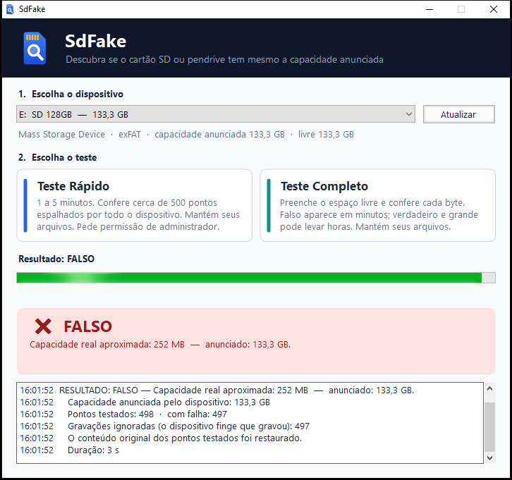
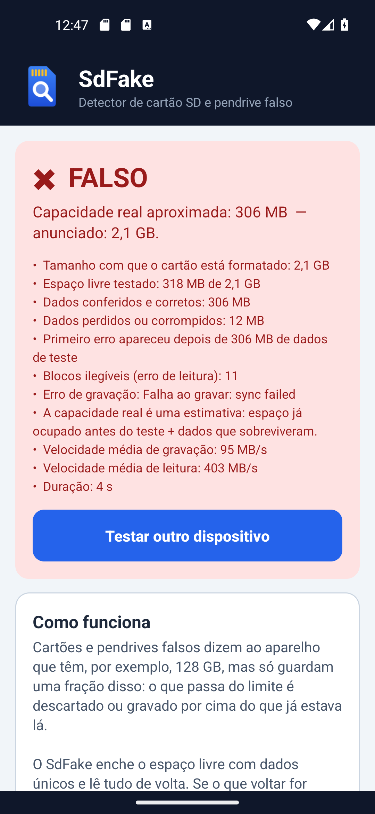
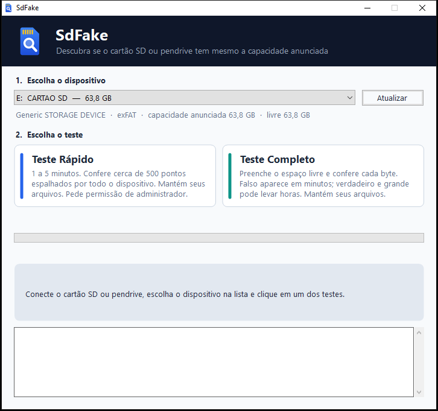
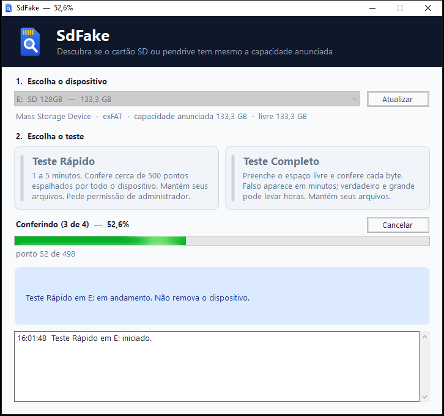
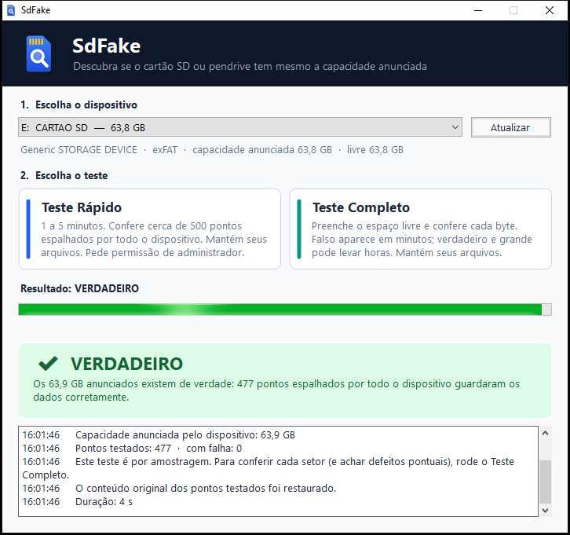
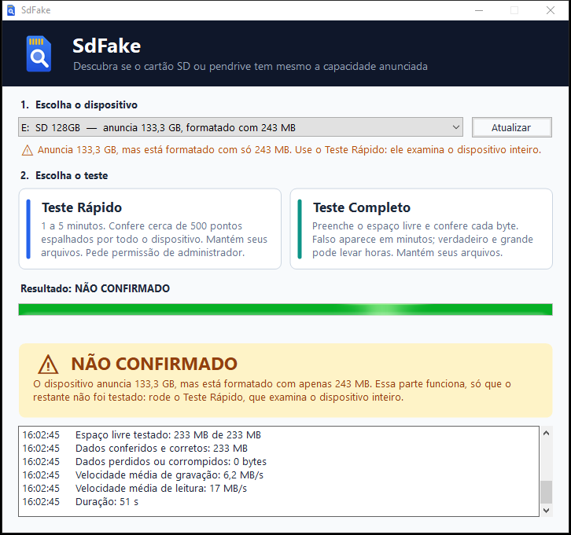
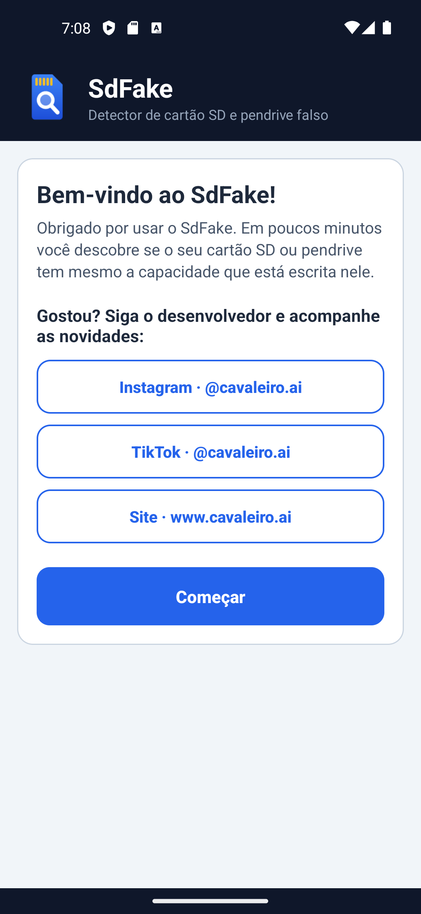
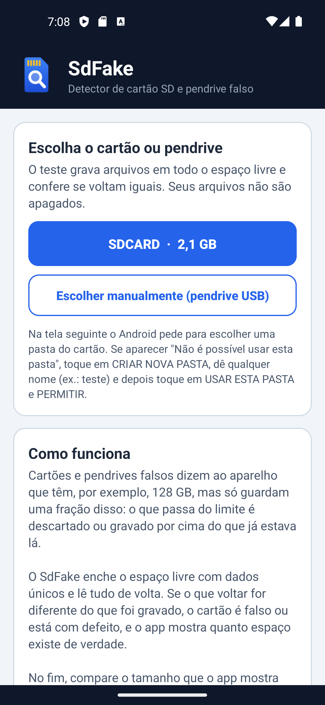
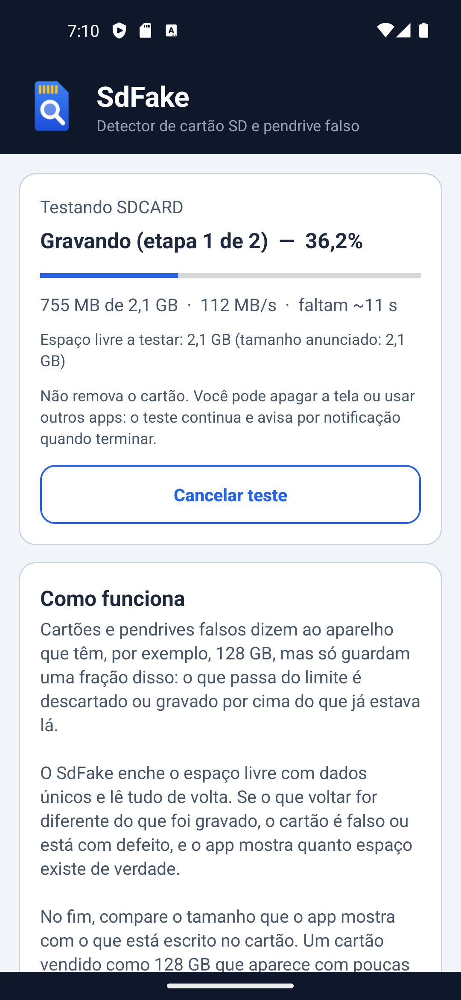
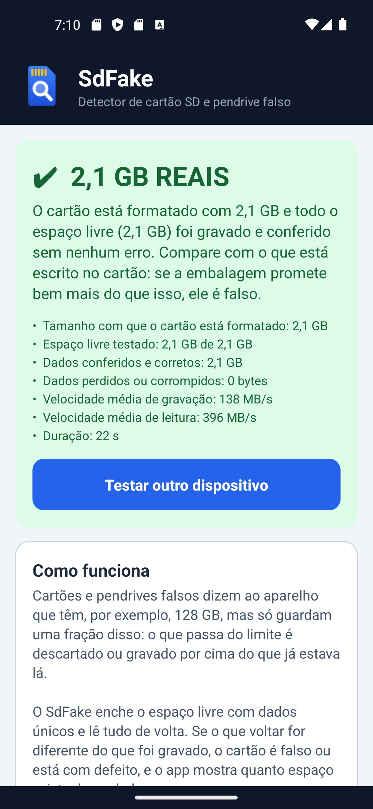

# SdFake — detector de cartão SD e pendrive falso

**Descubra se o seu cartão SD, pendrive ou disco USB tem mesmo a capacidade que está escrita nele.**
Programa para **Windows** e app para **Android**, grátis, em português e sem anúncios.

<p align="center">
  
  
</p>

> 📲 **Siga o [@cavaleiro.ai](https://www.instagram.com/cavaleiro.ai/) no Instagram** e no
> [TikTok](https://www.tiktok.com/@cavaleiro.ai) — é lá que saem as novidades e os próximos apps.
> Site: [www.cavaleiro.ai](https://www.cavaleiro.ai)

---

## Baixar

| Arquivo | Para quê |
| --- | --- |
| ⬇️ [**SdFake-Instalador.exe**](https://github.com/cavaleiro-ai/SdFake/releases/latest/download/SdFake-Instalador.exe) | Instala no Windows 10/11, com atalho no Menu Iniciar e na Área de Trabalho. Não pede administrador. |
| ⬇️ [**SdFake-Portatil.exe**](https://github.com/cavaleiro-ai/SdFake/releases/latest/download/SdFake-Portatil.exe) | O mesmo programa sem instalar: é só abrir. |
| ⬇️ [**SdFake.apk**](https://github.com/cavaleiro-ai/SdFake/releases/latest/download/SdFake.apk) | App para Android 7.0 ou mais novo. |

Todas as versões ficam na página de [Releases](https://github.com/cavaleiro-ai/SdFake/releases), com o
SHA-256 de cada arquivo.

> Os arquivos não têm assinatura digital paga. No Windows pode aparecer "O Windows protegeu o
> computador": clique em **Mais informações → Executar assim mesmo**. No Android, permita
> "instalar apps desconhecidos" quando ele pedir.

## O golpe

Cartões e pendrives falsos são baratos, vêm com "128 GB", "512 GB" ou "2 TB" na embalagem e o
computador **acredita** nesse número, porque o chip foi adulterado para mentir o tamanho. Só que
por dentro existem poucas centenas de megabytes. Tudo o que passa do limite real é jogado fora ou
gravado por cima do que já estava lá. Você só descobre quando as fotos e os vídeos aparecem
corrompidos.

O SdFake nasceu de um caso desses: um cartão vendido como **128 GB** que guardava **252 MB**.

## Como funciona, em uma frase

Ele grava dados únicos no dispositivo, lê de volta e compara. Se o que voltou não é o que foi
gravado, o cartão é falso (ou está com defeito), e o SdFake mostra **quanto espaço existe de verdade**.

## No computador (Windows)

1. Abra o SdFake e conecte o cartão ou pendrive. A lista atualiza sozinha.
2. Escolha o dispositivo e um dos dois testes.
3. Leia o resultado: **VERDADEIRO**, **FALSO** (com a capacidade real) ou **COM DEFEITO**.

<p align="center">
  
  
</p>
<p align="center">
  
  
</p>

| | ⚡ Teste Rápido | 🔬 Teste Completo |
| --- | --- | --- |
| Quanto demora | 1 a 5 minutos | Minutos num falso; horas num verdadeiro e grande |
| O que confere | Cerca de 500 pontos espalhados pelo dispositivo **inteiro** | **Todo** o espaço livre, byte por byte |
| Seus arquivos | Preservados (cada ponto é copiado antes e devolvido depois) | Preservados (só usa o espaço livre) |
| Administrador | Pede permissão | Não precisa |
| Melhor para | Saber rápido se a capacidade é real | Achar também defeitos pontuais |

**Na dúvida, comece pelo Teste Rápido.** Ele examina o dispositivo inteiro, mesmo que o cartão já
tenha sido reformatado com um tamanho menor.

## No celular (Android)

1. Instale o `SdFake.apk` e abra o app.
2. Toque no cartão SD que aparece na lista (ou em **Escolher manualmente** para pendrive no cabo OTG).
3. O Android pede uma pasta do cartão: toque em **Criar nova pasta**, dê qualquer nome, depois
   **Usar esta pasta** e **Permitir**.
4. Pode apagar a tela ou usar outros apps: o teste continua e avisa por notificação quando termina.

<p align="center">
  
  
  
  
</p>

No celular existe só o teste completo, porque o Android não deixa apps acessarem o cartão
diretamente. Pelo mesmo motivo o app mostra o tamanho que conferiu (por exemplo, **"243 MB REAIS"**)
para você comparar com o que está escrito no cartão.

## O que cada resultado quer dizer

| Resultado | Significado |
| --- | --- |
| ✔ **VERDADEIRO** | A capacidade anunciada existe e guardou os dados corretamente. |
| ✖ **FALSO** | O dispositivo guarda bem menos do que anuncia. O SdFake mostra a capacidade real aproximada. Peça o dinheiro de volta. |
| ⚠ **COM DEFEITO** | A capacidade parece real, mas alguns trechos corrompem dados. Não confie nele. |
| ⚠ **NÃO CONFIRMADO** | O teste só alcançou uma parte do dispositivo (cartão formatado com menos do que anuncia). Rode o Teste Rápido no PC. |
| **TESTE INCOMPLETO** | O teste foi cancelado ou interrompido antes de dar para concluir. |

## Seus arquivos e sua privacidade

- **Nenhum dos testes apaga seus arquivos.** O Teste Completo usa só o espaço livre e remove os
  arquivos de teste no final. O Teste Rápido guarda o conteúdo de cada ponto antes de gravar e
  devolve depois. Mesmo assim, se houver algo insubstituível no cartão, faça uma cópia antes.
- O disco do Windows nunca aparece na lista. HDs e SSDs externos aparecem, mas nunca vêm
  pré-selecionados e pedem uma confirmação a mais.
- O app Android recusa a memória interna do celular: só aceita cartão SD e pendrive.
- O SdFake **não usa a internet e não coleta nenhum dado**. O app Android nem pede a permissão de
  internet.

## Limitações

- **iPhone não é suportado.**
- No Android o veredito depende de você comparar o tamanho conferido com o da embalagem. Quem
  decide sem margem para dúvida é o Teste Rápido do PC.
- O Teste Completo só confere o espaço **livre**: quanto mais vazio o cartão, mais completa a
  conferência.
- O Teste Rápido é por amostragem. Ele descobre capacidade falsa, mas pode não achar um defeito
  pequeno e isolado. Para isso existe o Teste Completo.
- O programa de PC foi testado em Windows 10 com um cartão falso de verdade. O app Android foi
  validado no emulador (Android 14), incluindo um cartão falso simulado. Achou um problema no seu
  aparelho? [Abra uma issue](https://github.com/cavaleiro-ai/SdFake/issues).

## Documentação

- 📖 [Guia de uso](docs/COMO-USAR.md) — passo a passo no PC e no celular, dicas e perguntas frequentes.
- 🔍 [Como funciona por dentro](docs/COMO-FUNCIONA.md) — os dois algoritmos de teste e as proteções.
- 🛠️ [Desenvolvimento](docs/DESENVOLVIMENTO.md) — como compilar, testar, gerar os prints e publicar uma versão.
- 📝 [Histórico de versões](CHANGELOG.md)

## Para desenvolvedores

- **Windows:** C# com Windows Forms, compilado pelo `csc.exe` que já vem no Windows. Sem Visual
  Studio, sem NuGet, sem dependências.
- **Android:** Java puro, sem Gradle e sem bibliotecas: o APK é montado direto com as ferramentas
  do Android SDK. `minSdk 24`, `targetSdk 35`.
- O motor de teste é o mesmo nas duas plataformas e tem autoteste contra cartões falsos simulados.

```powershell
powershell -ExecutionPolicy Bypass -File pc\build.ps1    # programa + instalador + autoteste
python android\build_apk.py --test                       # APK assinado + autoteste
```

Detalhes em [docs/DESENVOLVIMENTO.md](docs/DESENVOLVIMENTO.md).

## Licença

[MIT](LICENSE). Use, modifique e distribua à vontade.

---

Feito por [**Cavaleiro AI**](https://www.cavaleiro.ai) ·
[Instagram](https://www.instagram.com/cavaleiro.ai/) ·
[TikTok](https://www.tiktok.com/@cavaleiro.ai)
