# Guia de uso do SdFake

Passo a passo para testar um cartão SD, pendrive ou disco USB no computador e no celular.
Para baixar, veja a página de [Releases](https://github.com/cavaleiro-ai/SdFake/releases/latest).

- [Antes de começar](#antes-de-começar)
- [No computador (Windows)](#no-computador-windows)
- [No celular (Android)](#no-celular-android)
- [Entendendo o resultado](#entendendo-o-resultado)
- [Perguntas frequentes](#perguntas-frequentes)

## Antes de começar

- **Quanto mais vazio o cartão, melhor.** O Teste Completo só confere o espaço livre.
- **Não remova o dispositivo durante o teste.**
- Se houver algo insubstituível no cartão, copie para outro lugar antes. Os testes preservam os
  arquivos, mas um cartão falso ou com defeito pode perder dados a qualquer momento, com ou sem teste.
- Use uma porta USB do próprio computador. Hubs e extensões ruins causam erros que não são culpa
  do cartão.

## No computador (Windows)

### Instalar

| Arquivo | O que faz |
| --- | --- |
| `SdFake-Instalador.exe` | Instala em `%LOCALAPPDATA%\Programs\SdFake`, cria atalhos no Menu Iniciar e na Área de Trabalho e aparece em "Aplicativos instalados" para desinstalar. Não pede administrador. |
| `SdFake-Portatil.exe` | É o programa em si. Não instala nada: abra e use. |

Funciona no Windows 10 e 11 sem instalar mais nada.

Se o Windows mostrar "O Windows protegeu o computador", clique em **Mais informações** e depois em
**Executar assim mesmo**. Isso aparece porque o programa não tem assinatura digital paga.

### Testar

  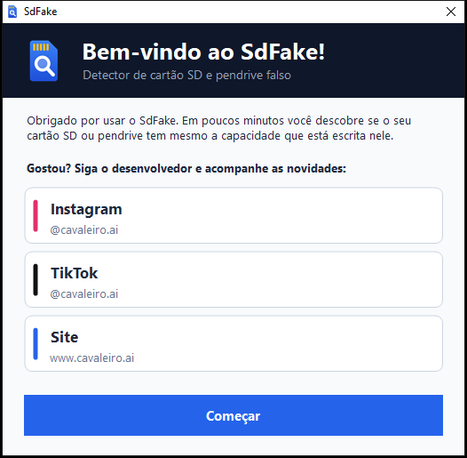
  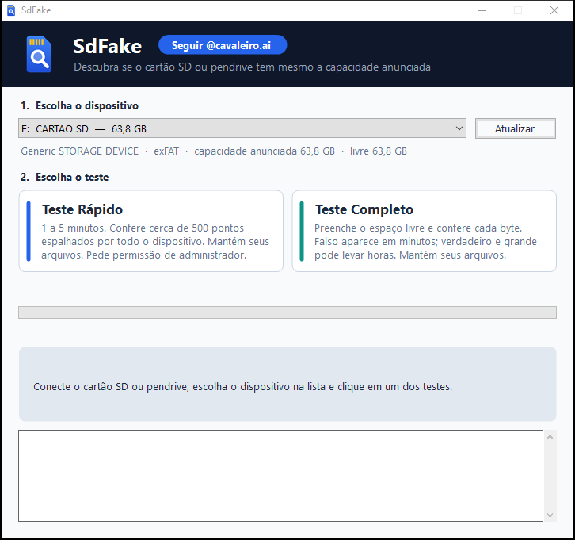

1. Abra o SdFake. A primeira tela é a de boas-vindas: clique em **Começar**.
2. Conecte o cartão (no leitor) ou o pendrive. A lista de dispositivos atualiza sozinha.
3. Confira na lista se o dispositivo escolhido é o que você quer testar.
4. Clique em um dos testes.

### Teste Rápido (1 a 5 minutos)

Confere cerca de 500 pontos espalhados pelo dispositivo inteiro. É o melhor primeiro teste.

- Pede **permissão de administrador**, porque lê e grava direto no dispositivo. O SdFake reabre
  sozinho pedindo essa permissão e começa o teste.
- O conteúdo de cada ponto é copiado antes e devolvido depois. No fim o programa confirma que
  tudo foi restaurado.
- Feche janelas do Explorador de Arquivos e programas que estejam usando o cartão.

  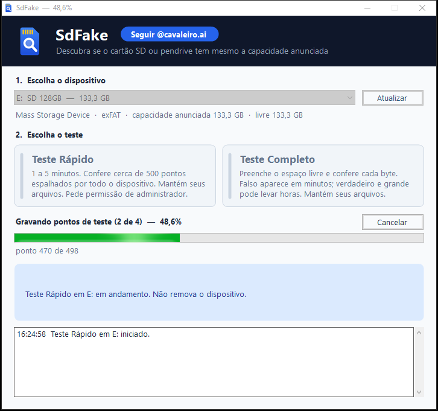
  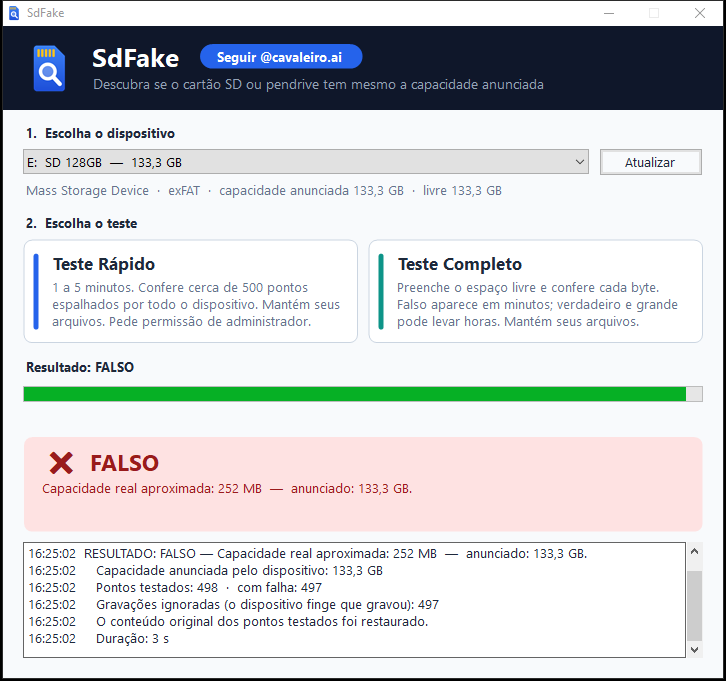

### Teste Completo (minutos a horas)

Enche o espaço livre com arquivos de teste, lê tudo de volta e apaga os arquivos no final.

- Não precisa de administrador e não mexe nos seus arquivos.
- Num cartão falso o erro aparece em poucos minutos e o teste para sozinho.
- Num cartão verdadeiro e grande demora, porque cada byte é gravado e lido. Um cartão de 128 GB a
  20 MB/s leva mais de 3 horas. O computador não entra em suspensão enquanto o teste roda.
- Os arquivos de teste ficam na pasta `SdFake_Teste` do cartão. Se o teste for interrompido à
  força (queda de energia, cartão arrancado), essa pasta pode sobrar: ela é apagada no próximo
  teste, ou você pode apagar à mão.

  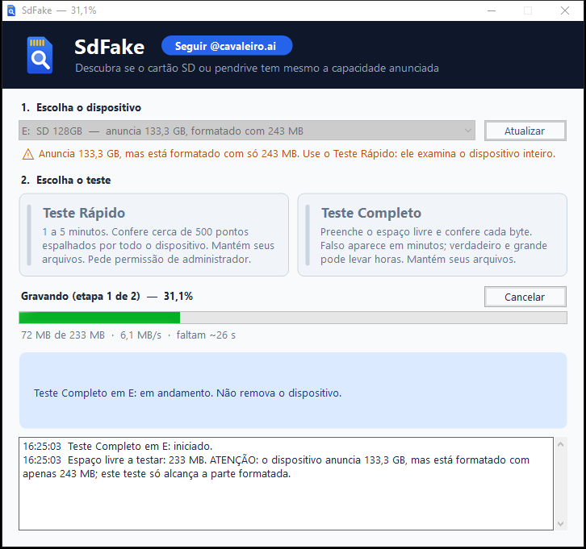
  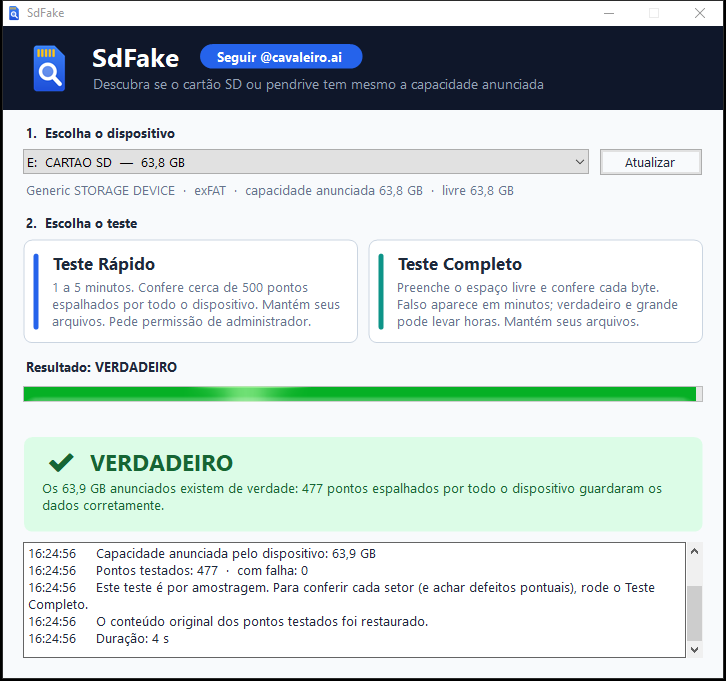

### Cartão formatado com menos do que anuncia

Um cartão falso pode já ter sido reformatado no tamanho real. Exemplo: o dispositivo anuncia
133 GB, mas a partição tem 243 MB. O Teste Completo só enxerga a parte formatada, e ela funciona.

O SdFake percebe a diferença entre o tamanho formatado e o que o dispositivo anuncia:

- avisa em laranja assim que você escolhe o dispositivo;
- antes do Teste Completo, oferece rodar o Teste Rápido no lugar;
- nunca responde VERDADEIRO só pela parte formatada: mostra **NÃO CONFIRMADO**;
- se o Teste Rápido já foi feito na mesma sessão, usa o resultado dele para dar o veredito final.

  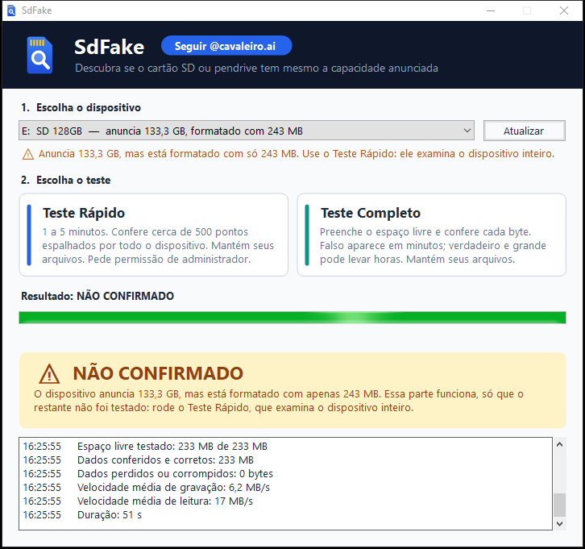

### Botão Seguir

No topo da janela, ao lado do título, o botão **Seguir @cavaleiro.ai** abre um menu com o
Instagram, o TikTok e o site do desenvolvedor. O mesmo botão existe no app Android.

  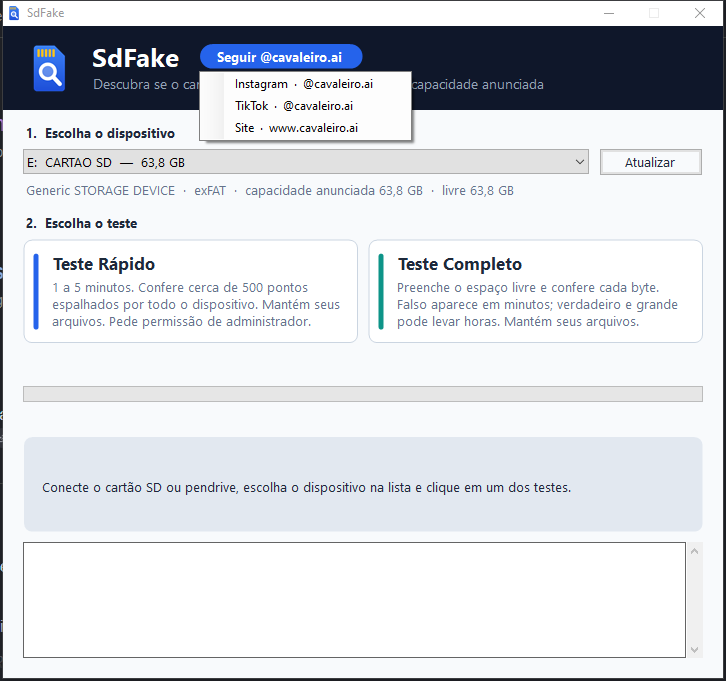
  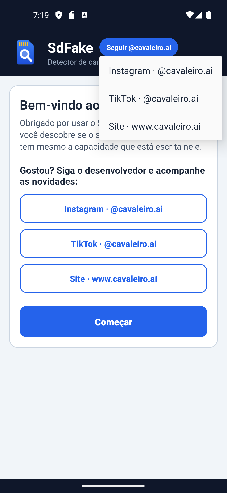

### HD e SSD externos

Discos USB externos aparecem na lista, marcados como "disco USB externo". Eles nunca vêm
pré-selecionados e pedem uma confirmação a mais, com o padrão em "Não". O disco do Windows nunca
aparece.

## No celular (Android)

### Instalar

1. Baixe o `SdFake.apk` no celular (ou copie do computador).
2. Toque no arquivo. O Android pede para permitir "instalar apps desconhecidos": permita e volte.
3. Toque em **Instalar**. Se o Play Protect avisar, escolha **Instalar mesmo assim**.

Requer Android 7.0 ou mais novo.

### Testar

  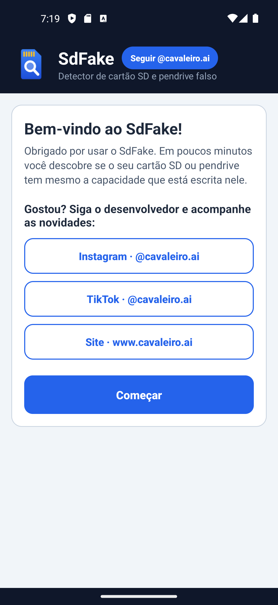
  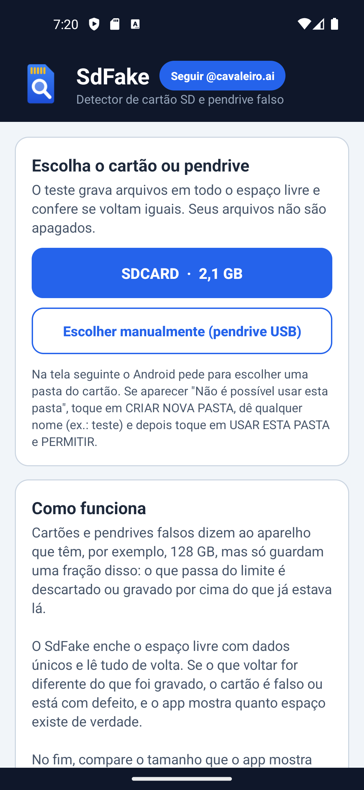
  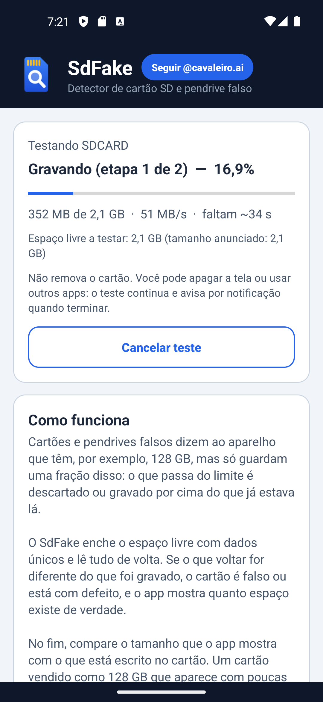

1. Abra o app e toque em **Começar**.
2. Toque no cartão SD da lista. Para pendrive ou leitor no cabo OTG, use **Escolher manualmente**.
3. O Android abre a tela de escolha de pasta. Toque em **Criar nova pasta**, dê qualquer nome
   (por exemplo `teste`), depois em **Usar esta pasta** e **Permitir**.
   O Android 11 ou mais novo não deixa nenhum app usar a pasta principal do cartão; por isso é
   preciso criar uma pasta.
4. Confirme. O teste começa e mostra o andamento.
5. Pode apagar a tela ou trocar de app. O andamento fica na notificação e outra notificação avisa
   quando terminar. Deixe o celular carregando se o cartão for grande.

  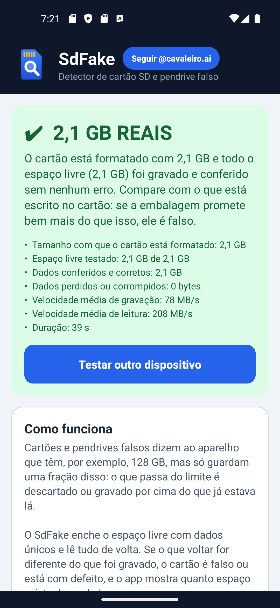
  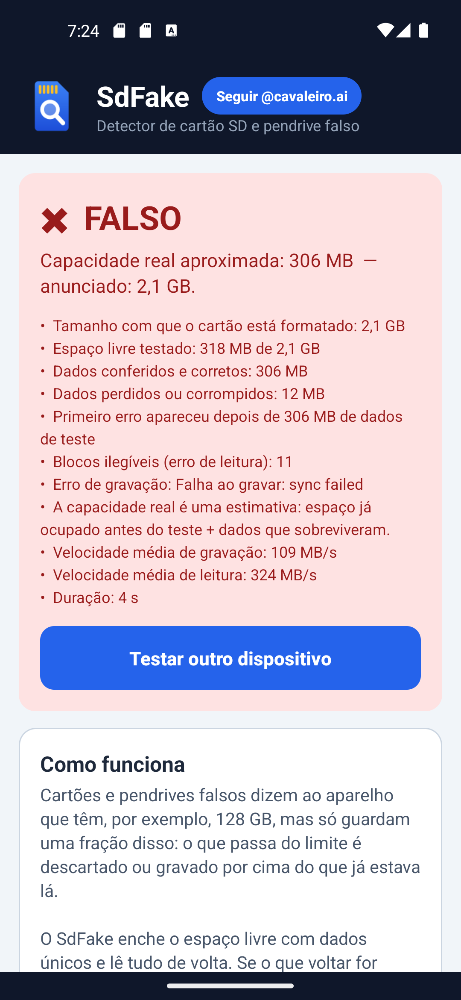

### O que é diferente no celular

- Só existe o teste completo. O Android não deixa apps acessarem o dispositivo diretamente, que é
  o que o Teste Rápido do PC faz.
- O app não consegue saber quanto o dispositivo anuncia, só o tamanho com que está formatado. Por
  isso o resultado bom aparece como **"X REAIS"** (por exemplo, "243 MB REAIS"): compare esse
  número com o que está escrito no cartão. Se a embalagem promete muito mais, ele é falso.
- Quando o tamanho conferido é pequeno demais para um cartão atual, o resultado fica em alerta.
- O app recusa a memória interna do celular.
- Se o app não conseguir garantir que leu do cartão (e não da memória do aparelho), o resultado
  sai como **NÃO CONFIRMADO** em vez de arriscar um "verdadeiro" errado.

## Entendendo o resultado

| Resultado | O que aconteceu | O que fazer |
| --- | --- | --- |
| ✔ **VERDADEIRO** / **X REAIS** | Tudo o que foi gravado voltou igual. | Pode usar. No Android, compare o tamanho mostrado com o da embalagem. |
| ✖ **FALSO** | O dispositivo descartou ou sobrescreveu dados depois de certo ponto. | Não use para nada importante. Peça reembolso: o resultado mostra a capacidade real aproximada. |
| ⚠ **COM DEFEITO** | A capacidade parece real, mas alguns trechos voltaram corrompidos. | Não confie nele. Pode ser cartão velho, de má qualidade ou mau contato: repita em outra porta ou leitor. |
| ⚠ **NÃO CONFIRMADO** | O teste só alcançou parte do dispositivo, ou não deu para garantir a leitura. | Rode o Teste Rápido no PC. |
| **TESTE INCOMPLETO** | Foi cancelado ou interrompido. | Rode de novo. |
| **ERRO** | O teste não conseguiu começar ou continuar (cartão protegido contra gravação, removido, sem permissão). | Leia a mensagem, corrija e repita. |

A janela de baixo (no PC) e a lista do resultado (no celular) trazem os detalhes: quanto foi
conferido, quanto se perdeu, velocidade de gravação e leitura e a duração.

## Perguntas frequentes

**O teste apaga meus arquivos?**
Não. O Teste Completo só grava no espaço livre e remove o que gravou. O Teste Rápido devolve o
conteúdo original de cada ponto que tocou.

**Meu cartão deu FALSO. Dá para aproveitar?**
Dá para reformatar com o tamanho real e usar como um cartão pequeno, mas a qualidade desses chips
costuma ser ruim. Não guarde nele nada que você não possa perder.

**Deu VERDADEIRO no Teste Completo, mas o cartão mostra bem menos espaço que o da embalagem.**
É o caso do cartão falso que já foi reformatado no tamanho real. As versões atuais do SdFake
mostram NÃO CONFIRMADO nessa situação. Rode o Teste Rápido.

**Por que o Teste Rápido pede administrador?**
Porque o Windows só deixa ler e gravar direto no dispositivo (fora dos arquivos) com essa
permissão. O Teste Completo não precisa dela.

**O tamanho mostrado é um pouco menor que o da embalagem. É falso?**
Não. Um cartão de "64 GB" aparece com cerca de 63,8 GB, e o Windows ainda costuma mostrar "59 GB"
porque conta em outra unidade (GiB). Falso é quando existe uma fração pequena do anunciado.

**Quanto tempo demora o Teste Completo?**
Tamanho livre dividido pela velocidade, duas vezes (gravar e ler). A velocidade aparece durante o
teste, junto com o tempo que falta.

**Funciona com HD externo, SSD e leitor de cartão?**
Sim, com qualquer armazenamento USB que apareça como unidade no Windows. No Android, cartão SD e
pendrive OTG.

**Funciona no iPhone, Mac ou Linux?**
Não. Só Windows 10/11 e Android 7.0 ou mais novo.

**O programa manda algum dado para a internet?**
Não. Ele não se conecta a nada. Os botões da tela de boas-vindas e o botão Seguir apenas abrem o
Instagram, o TikTok e o site no seu navegador, se você clicar.
